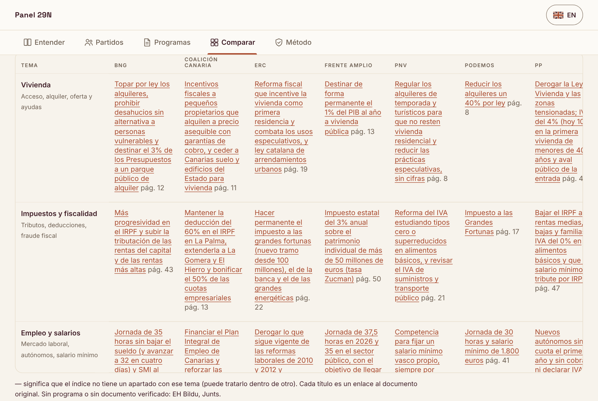
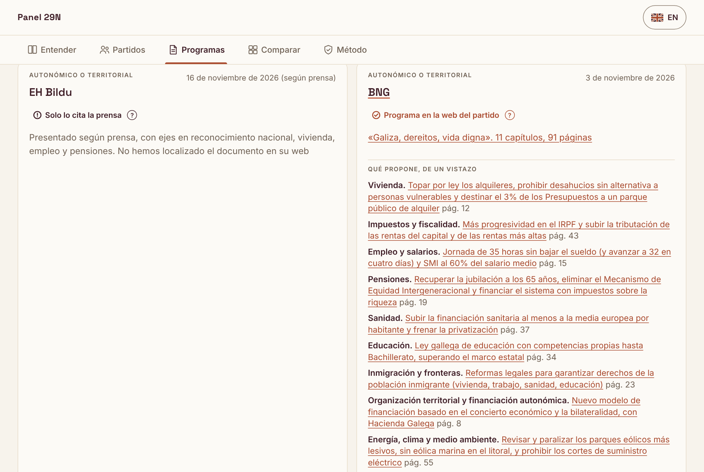
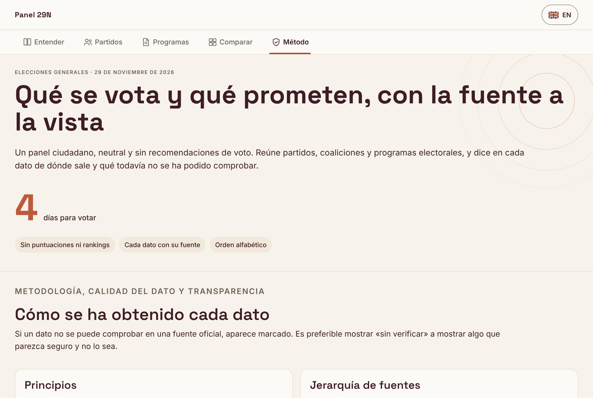

<a href="README.md">English</a> · <b>Español</b>

  

  <a href="https://yael-parra.github.io/Spanish-Elections/"><b>Abrir el panel →</b></a>

---

## El problema

España vota el 29 de noviembre de 2026. Los programas electorales tienen cientos de páginas, cada partido los publica un día distinto y la mayoría de los resúmenes mezclan datos con opinión. Saber qué propone de verdad un partido, y dónde lo dice, lleva horas.

**Panel 29N pone las propuestas de cada partido en paralelo, como texto, con la frase enlazada a la página exacta del documento original.** No recomienda voto, no puntúa ni ordena partidos.

## Cómo funciona

1. **Recoger.** Cada programa se toma de la web del propio partido, o de una copia alojada en otro sitio cuando es la única que se ha encontrado, y se indica así.
2. **Indexar.** Se lee el índice de cada documento y cada apartado se asigna a un tema: vivienda, impuestos, empleo, pensiones, sanidad, educación, inmigración, territorio, energía, instituciones, política exterior y mundo rural.
3. **Citar y enlazar.** Para cada tema se muestra una propuesta con su página impresa y un enlace que abre el documento en ese punto.
4. **Decir lo que falta.** Si un partido no tiene documento publicado, el panel lo dice en lugar de rellenar el hueco con lo que cuente la prensa.

## Principios

- **Neutral por diseño.** Orden alfabético, sin puntuaciones, sin rankings y sin consejo de voto.
- **Cada dato con su fuente.** Cada cifra y cada propuesta indica de dónde sale y cuándo.
- **La prensa no es un programa.** Los discursos de mitin y los resúmenes de prensa no se usan para atribuir propuestas. Un partido que solo consta por prensa aparece como tal y queda fuera de la comparación.
- **Honestidad sobre la calidad del dato.** La pestaña Método lista cada dato con su tipo, sus fuentes y cómo se verificó.
- **Un archivo, sin rastreo.** Un único HTML, con fuentes incrustadas, sin cookies y sin peticiones a terceros.
- **Bilingüe.** Español e inglés, con selector arriba a la derecha.

## Qué contiene

**Entender.** Qué se decide el 29N y cómo funciona el voto, con cifras y calendario.

**Partidos.** Partidos y coaliciones registrados, con sus cabezas de lista.

**Programas.** Quién ha publicado qué, cuándo, cuánto ocupa, y una lista corta de propuestas por partido.

**Comparar.** Una fila por tema, una columna por partido, cada celda enlazada a su página.

**Método.** La calidad del dato uno a uno y los límites conocidos.

## Estado

Datos a 25 de noviembre de 2026. EH Bildu y Junts no tienen un documento de programa localizable. Podemos enlaza a un PDF completo alojado por un medio, porque no se pudo comprobar en la web del partido. El panel se retirará pasado el día de las elecciones.

---

## Sobre la autora

  <a href="https://www.linkedin.com/in/yael-parra/">
    
    &nbsp;
    
  </a>

Consultora de IA y creadora de producto. Trabajo en los dos lados: ayudar a las empresas a adoptar IA y construir las herramientas.

Panel 29N es un proyecto cívico personal, hecho de principio a fin: fuentes, modelado de datos, diseño y despliegue. No tiene afiliación política ni financiación.

Si quieren hablar de datos cívicos, IA o producto, me encuentran en [linkedin.com/in/yael-parra](https://www.linkedin.com/in/yael-parra/).
