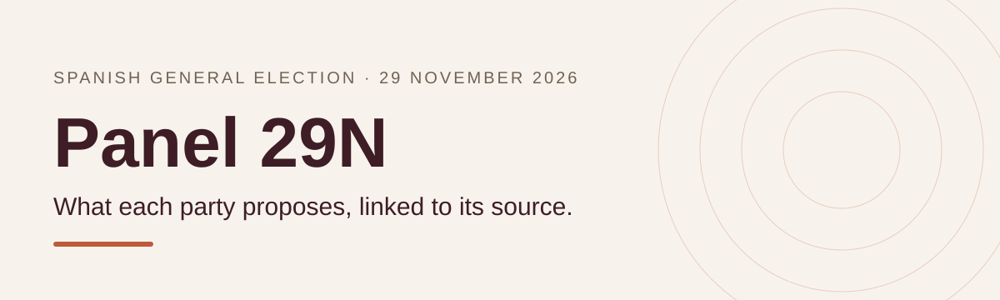
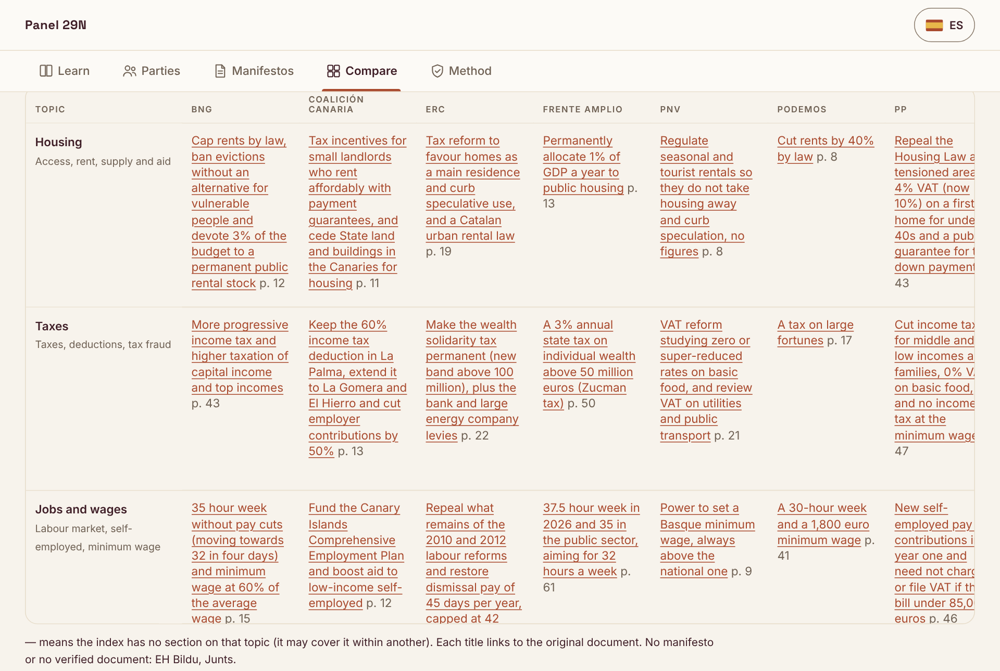
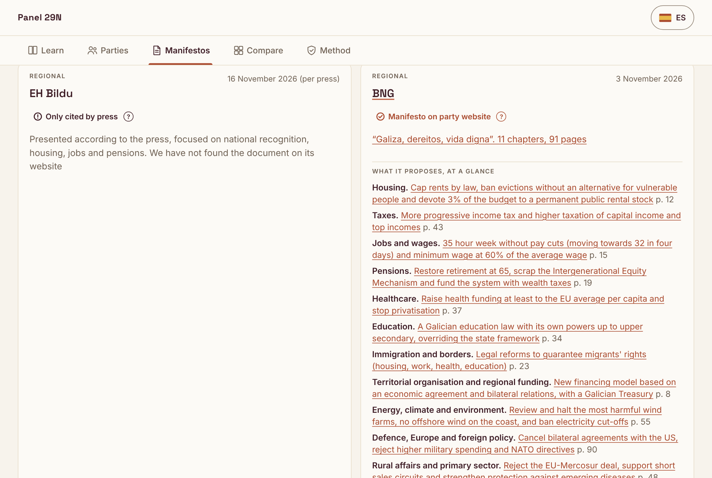
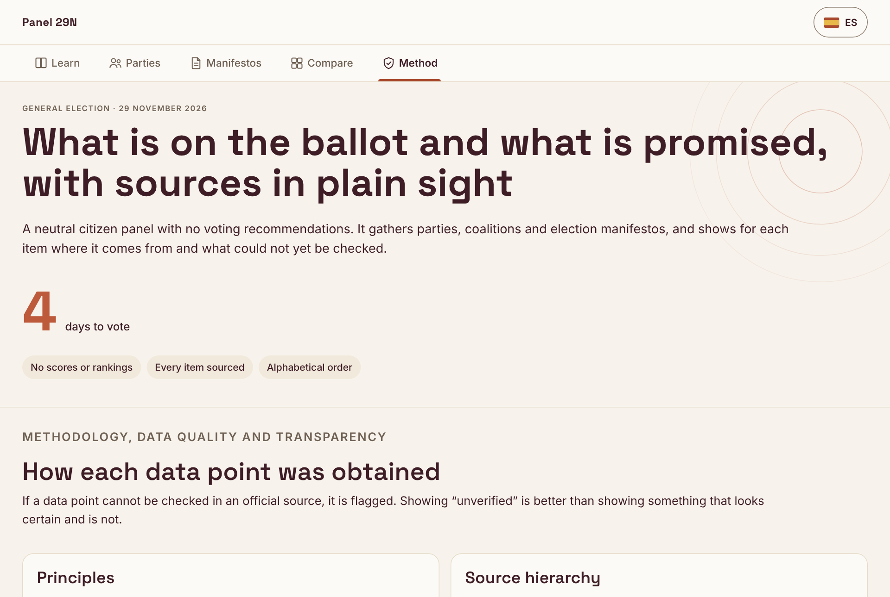

<b>English</b> · <a href="README.es.md">Español</a>

  

  <a href="https://yael-parra.github.io/Spanish-Elections/"><b>Open the live panel →</b></a>

---

## The problem

Spain votes on 29 November 2026. Election manifestos run to hundreds of pages, parties publish them on different days, and most summaries mix facts with opinion. Finding out what a party actually proposes, and where it says it, takes hours.

**Panel 29N puts each party's proposals side by side, as plain text, with the phrase linked to the exact page of the source document.** It does not recommend a vote, score parties or rank them.

## How it works

1. **Collect.** Each manifesto is taken from the party's own website, or from a copy hosted elsewhere when that is the only one found, and it is labelled as such.
2. **Index.** The table of contents of each document is read, and every section is assigned to a topic: housing, taxes, jobs, pensions, healthcare, education, immigration, territory, energy, institutions, foreign policy, rural affairs.
3. **Quote and link.** For each topic, one proposal is shown with its printed page and a link that opens the document there.
4. **Say what is missing.** If a party has no published document, the panel says so instead of filling the gap with press claims.

## Principles

- **Neutral by construction.** Alphabetical order, no scores, no rankings, no voting advice.
- **Every item has a source.** Each figure and proposal shows where it comes from and when.
- **Press is not a manifesto.** Rally speeches and news summaries are not used to attribute proposals. A party known only through the press appears as such and is left out of the comparison.
- **Honest about quality.** The Method tab lists each data point with its type, sources and how it was verified.
- **One file, no tracking.** A single HTML file, fonts embedded, no cookies, no third party requests.
- **Bilingual.** Spanish and English, switchable from the top right corner.

## What's inside

**Learn.** What is decided on 29N and how the vote works, with figures and calendar.

**Parties.** Parties and coalitions registered, with their lead candidates.

**Manifestos.** Who has published what, when, how long it is, and a short list of proposals per party.

**Compare.** One row per topic, one column per party, each cell linked to the page.

**Method.** Data quality item by item, and the known limits.

## Status

Data as of 25 November 2026. EH Bildu and Junts have no manifesto document that could be located. Podemos is linked to a full PDF hosted by a news outlet, because it could not be checked on the party website. The panel will be taken down after election day.

---

## About me

  <a href="https://www.linkedin.com/in/yael-parra/">
    
    &nbsp;
    
  </a>

I'm an AI consultant and product builder. I work on both sides: helping companies adopt AI and building the tools myself.

Panel 29N is a personal civic project, built end to end: sourcing, data modelling, design and deployment. It has no political affiliation and no funding.

If you want to talk about civic data, AI or product, find me at [linkedin.com/in/yael-parra](https://www.linkedin.com/in/yael-parra/).
